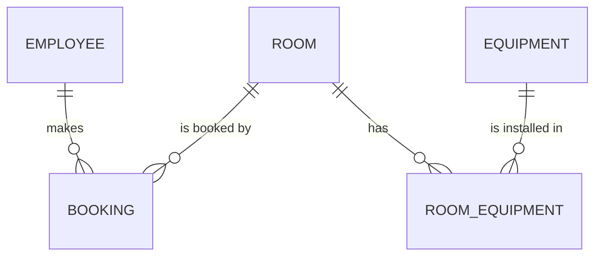

# Entity Model

## Entity Relationship Diagram

### EMPLOYEE

A person who signs in with the company's single sign-on, created or updated from the single sign-on data at each sign-in.

| Attribute   | Description                                        | Data Type | Length/Precision | Validation Rules                |
|-------------|----------------------------------------------------|-----------|------------------|---------------------------------|
| id          | Unique identifier                                  | Long      | 19               | Primary Key, Sequence           |
| sso_subject | Identifier of the Employee in the single sign-on   | String    | 255              | Not Null, Unique                |
| name        | Full name shown on the Employee's Bookings         | String    | 100              | Not Null                        |
| email       | Email address from the single sign-on              | String    | 255              | Not Null, Unique, Format: Email |

### ROOM

A meeting room of the office that Employees can book while it is active.

| Attribute | Description                                          | Data Type | Length/Precision | Validation Rules          |
|-----------|------------------------------------------------------|-----------|------------------|---------------------------|
| id        | Unique identifier                                    | Long      | 19               | Primary Key, Sequence     |
| name      | Name of the Room as shown to Employees               | String    | 50               | Not Null, Unique          |
| capacity  | Maximum number of people the Room seats              | Integer   | 10               | Not Null, Min: 1, Max: 100 |
| active    | Whether the Room can be booked (false: deactivated)  | Boolean   | 1                | Not Null                  |

### EQUIPMENT

A kind of fixed facility a Room can have, such as a projector or video conferencing.

| Attribute | Description                    | Data Type | Length/Precision | Validation Rules      |
|-----------|--------------------------------|-----------|------------------|-----------------------|
| id        | Unique identifier              | Long      | 19               | Primary Key, Sequence |
| name      | Name of the kind of Equipment  | String    | 50               | Not Null, Unique      |

### ROOM_EQUIPMENT

Links a Room to each kind of Equipment installed in it.

| Attribute    | Description                  | Data Type | Length/Precision | Validation Rules                         |
|--------------|------------------------------|-----------|------------------|------------------------------------------|
| room_id      | The Room                     | Long      | 19               | Primary Key, Foreign Key (ROOM.id)       |
| equipment_id | The Equipment in the Room    | Long      | 19               | Primary Key, Foreign Key (EQUIPMENT.id)  |

### BOOKING

An Employee's claim on one Room for one Time Slot; a cancelled Booking is deleted.

| Attribute   | Description                              | Data Type | Length/Precision | Validation Rules                    |
|-------------|------------------------------------------|-----------|------------------|-------------------------------------|
| id          | Unique identifier                        | Long      | 19               | Primary Key, Sequence               |
| room_id     | The booked Room                          | Long      | 19               | Not Null, Foreign Key (ROOM.id)     |
| employee_id | The Employee who made the Booking        | Long      | 19               | Not Null, Foreign Key (EMPLOYEE.id) |
| start_time  | Start of the Time Slot                   | DateTime  | -                | Not Null                            |
| end_time    | End of the Time Slot                     | DateTime  | -                | Not Null                            |
| created_at  | When the Employee made the Booking       | DateTime  | -                | Not Null                            |

#### Constraints

- end_time must be after start_time, on the same day.
- start_time and end_time fall on a 15-minute step (minutes 00, 15, 30, or 45).
- The Time Slot lasts at least 15 minutes and at most 4 hours.
- start_time is at most 90 days after created_at.
- Two Bookings of the same Room never overlap: for the same room_id, one Booking's start_time is not before the other's end_time, or vice versa.
